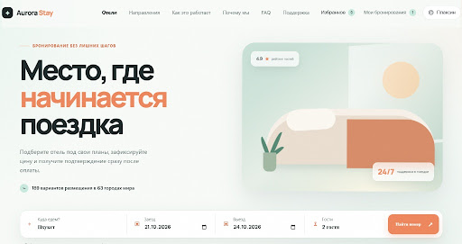
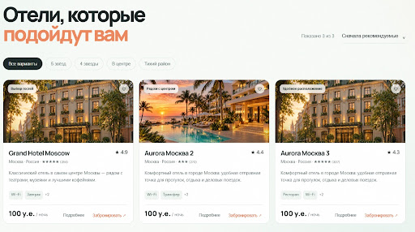
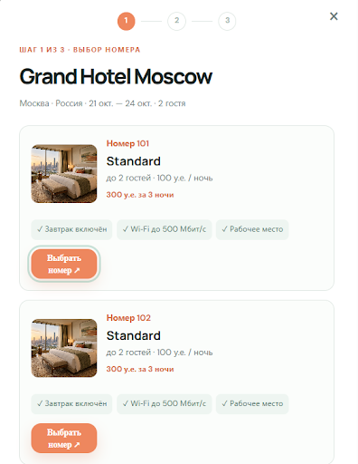
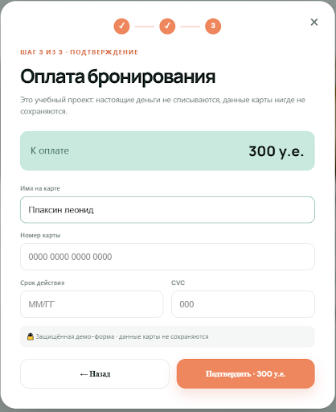
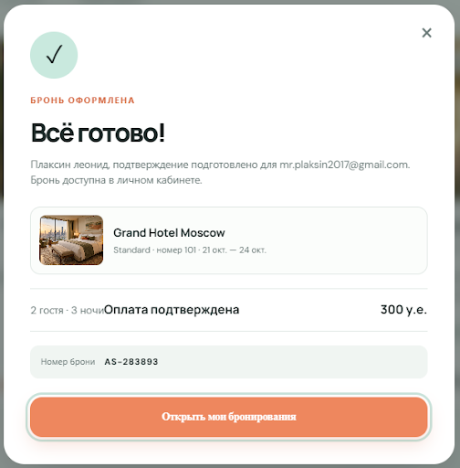
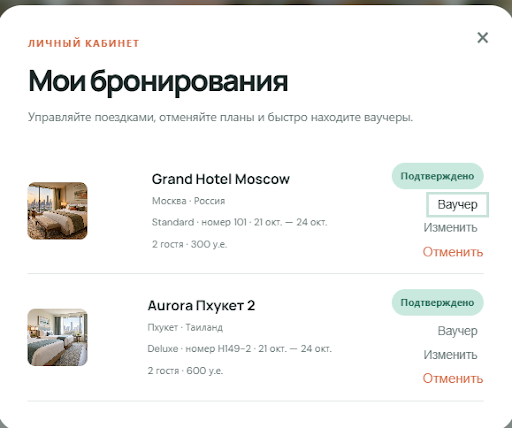
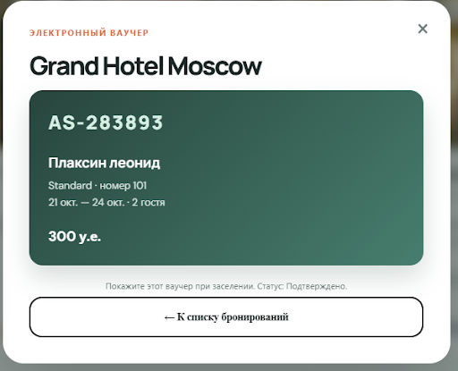
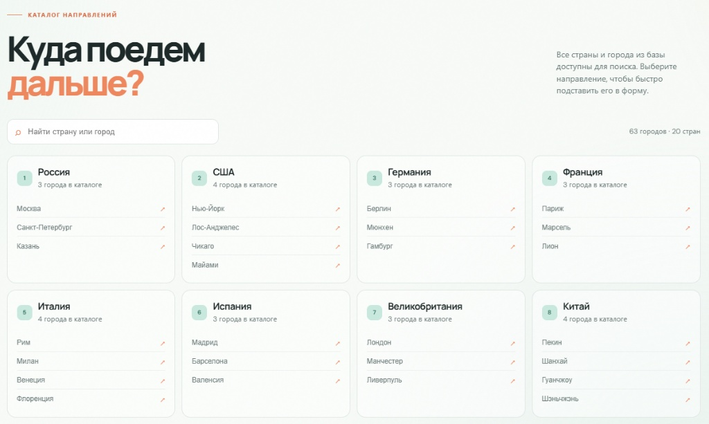
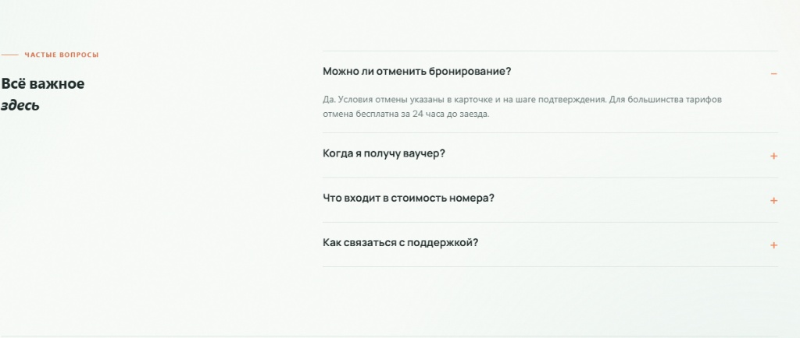
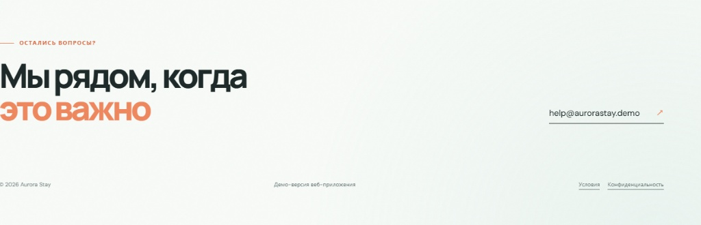

# Aurora Stay — Сервис бронирования отелей

Современное веб-приложение для поиска, выбора и онлайн-бронирования отелей по всему миру. Проект включает в себя интерактивную поисковую панель, фильтрацию вариантов, многошаговый процесс бронирования с симуляцией оплаты, личный кабинет с управлением бронями и электронными ваучерами.

---

##  Технологии

* **Frontend:** HTML5, CSS3, JavaScript (ES6+)
* **Интерфейс:** Адаптивный UI, модальные окна, интерактивные шаги оформления

---

##  Обзор страниц и функционала сайта

### 1. Главный экран (Hero Section и поисковый виджет)

* **Назначение:** Быстрый старт поиска отелей и навигация по сайту.
* **Функционал:**
  * Верхняя панель навигации (*Отели, Направления, Как это работает, Почему мы, FAQ, Поддержка*), а также счетчики избранного, личного кабинета и профиля пользователя.
  * Удобный поисковый виджет: выбор направления (город/страна), дат заезда и выезда, а также количества гостей с кнопкой **«Найти номер»**.

---

### 2. Статистика и ключевые преимущества платформы

* **Назначение:** Демонстрация масштаба сервиса и надежности условий.
* **Функционал:**
  * Индикаторы базы данных: количество отелей в каталоге, стран и городов для путешествий.
  * Блоки с ключевыми гарантиями: гибкие условия отмены, отсутствие скрытых сборов, мгновенное подтверждение и круглосуточная поддержка.
  * Быстрые теги для выбора популярных направлений (Москва, Санкт-Петербург, Токио).

---

### 3. Каталог отелей и фильтрация

* **Назначение:** Подбор подходящего варианта размещения с сортировкой и фильтрами.
* **Функционал:**
  * Фильтрация отелей по звездности (5 звёзд, 4 звезды), расположению (*в центре*, *тихий район*) и категории.
  * Карточки отелей с указанием рейтинга гостей, фотографий, краткого описания, доступных удобств (Wi-Fi, завтрак, трансфер) и стоимости за ночь.
  * Кнопки перехода к подробной информации (**«Подробнее»**) и быстрому бронированию (**«Забронировать»**).

---

### 4. Шаг 1 из 3 — Выбор номера в отеле

* **Назначение:** Выбор конкретной категории номера и ознакомление с деталями размещения.
* **Функционал:**
  * Отображение выбранных дат и количества гостей.
  * Список доступных номеров (например, *Standard*) с фото, вместимостью, ценой за сутки и общей стоимостью за весь период проживания.
  * Перечень удобств в номере (завтрак включен, высокоскоростной Wi-Fi, рабочее место).
  * Кнопка **«Выбрать номер»** для перехода к оформлению.

---

### 5. Шаг 2 из 3 — Ввод данных гостя

* **Назначение:** Сбор информации о человеке, который будет заселяться.
* **Функционал:**
  * Информационная сводка по выбранному отелю, номеру, датам и итоговой цене.
  * Поля ввода персональных данных: имя и фамилия, email для получения ваучера и подтверждения, телефон, а также комментарий для отеля (время прибытия, пожелания).
  * Чек-бокс согласия с условиями бронирования и обработки персональных данных.

---

### 6. Шаг 3 из 3 — Оплата бронирования

* **Назначение:** Безопасная симуляция проведения платежа за номер.
* **Функционал:**
  * Поля ввода данных банковской карты (имя держателя, номер карты, срок действия, CVC-код).
  * Информационная плашка о демо-режиме (настоящие деньги не списываются).
  * Кнопка **«Подтвердить»** для успешного завершения оплаты.

---

### 7. Подтверждение бронирования

* **Назначение:** Финальное уведомление гостя об успешной оплате и бронировании.
* **Функционал:**
  * Отображение уникального номера бронирования (например, `AS-283893`).
  * Информация об отправке подтверждения на email.
  * Кнопка быстрого перехода в **«Мои бронирования»**.

---

### 8. Личный кабинет — Мои бронирования

* **Назначение:** Управление поездками и бронированиями пользователя.
* **Функционал:**
  * Список текущих и прошлых бронирований со статусом (*Подтверждено*).
  * Кнопки просмотра электронного ваучера, изменения деталей или отмены поездки.

---

### 9. Электронный ваучер для заселения

* **Назначение:** Цифровой документ для предъявления в отеле при заезде.
* **Функционал:**
  * Готовый ваучер с кодом брони, ФИО гостя, категорией номера, датами и статусом подтверждения.

---

### 10. Как это работает (Процесс в 3 шага)

* **Назначение:** Простая инструкция для пользователя.
* **Функционал:**
  * 1. **Выберите направление:** Укажите город, даты и гостей.
  * 2. **Сравните условия:** Смотрите рейтинг, удобства и отзывы.
  * 3. **Получите подтверждение:** Бронь появляется в кабинете, а ваучер приходит на email.

---

### 11. Каталог направлений

* **Назначение:** Удобный поиск по странам и городам из базы.
* **Функционал:**
  * Строка поиска страны или города.
  * Группировка по странам (Россия, США, Германия, Франция, Италия, Испания, Великобритания, Китай) с быстрыми ссылками на города.

---

### 12. Забота о деталях и преимущества

* **Назначение:** Подчеркивание удобства и безопасности сервиса.
* **Функционал:**
  * **Честная цена:** Фиксированная стоимость без скрытых сборов.
  * **Планы под контролем:** Изменение или отмена бронирования до заезда.
  * **Поддержка рядом:** Круглосуточная помощь 24/7.

---

### 13. Частые вопросы (FAQ)

* **Назначение:** Ответы на популярные вопросы пользователей.
* **Функционал:**
  * Раскрывающийся аккордеон с ответами про условия отмены, получение ваучера, состав стоимости и связь с поддержкой.

---

### 14. Поддержка и подвал сайта

* **Назначение:** Контактные данные и юридическая информация.
* **Функционал:**
  * Прямой адрес электронной почты поддержки (`help@aurorastay.demo`).
  * Ссылки на условия использования и политику конфиденциальности.
